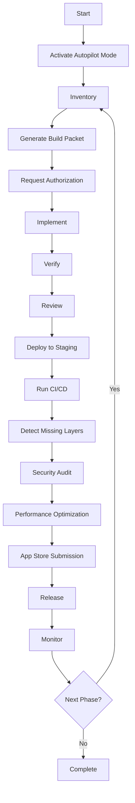

# SIGIL OS Master Workflow

This workflow coordinates all skills and processes for building SIGIL OS from foundations to app store submission.

## Workflow Overview

## Phase 0: Foundations (Weeks 1-4)

### Steps

1. **Activate Autopilot Mode**
   - Invoke `sigil-autopilot-orchestrator`
   - Emit activation sigil

2. **Inventory Repository**
   - Check architecture documents
   - Check requirements
   - Check existing implementation
   - Detect missing components

3. **Generate Build Packet**
   - Define scope
   - Define acceptance criteria
   - Define verification steps
   - Emit build packet sigil

4. **Implement Foundations**
   - Invoke `sigil-builder`
   - Implement sigil type
   - Implement signing
   - Implement verification
   - Implement persistence
   - Implement HTTP API
   - Implement CLI
   - Emit sigil for each change

5. **Verify Foundations**
   - Run `cargo build`
   - Run `cargo test`
   - Run `cargo clippy`
   - Run `cargo fmt --check`
   - Emit verification sigil

6. **Detect Missing Layers**
   - Invoke `missing-layer-detector`
   - Generate missing layer report
   - Emit detection sigil

### Exit Criteria

- [ ] cargo test passes
- [ ] /health responds
- [ ] All foundations implemented
- [ ] No critical missing layers

## Phase 1: Warrant (Weeks 5-8)

### Steps

1. **Generate Build Packet**
   - Define warrant implementation scope
   - Define cryptographic requirements
   - Emit build packet sigil

2. **Implement Warrant**
   - Invoke `sigil-builder`
   - Implement device attestation
   - Implement rollback mechanism
   - Implement every-state-change-emits-sigil
   - Emit sigil for each change

3. **Security Audit**
   - Invoke `security-auditor`
   - Review cryptographic implementation
   - Verify security controls
   - Emit audit sigil

4. **Verify Warrant**
   - Run cryptographic tests
   - Run security tests
   - Emit verification sigil

### Exit Criteria

- [ ] Every state change emits sigil
- [ ] Sigil signatures verify
- [ ] Rollback keys work
- [ ] Security audit passes

## Phase 2: Substrate (Weeks 9-12)

### Steps

1. **Generate Build Packet**
   - Define substrate implementation scope
   - Emit build packet sigil

2. **Implement Substrate**
   - Invoke `sigil-builder`
   - Implement delta-state
   - Implement epistemic half-life
   - Implement cognitive pressure
   - Implement quarantine
   - Implement immune system
   - Emit sigil for each change

3. **Performance Optimization**
   - Invoke `performance-optimizer`
   - Profile substrate performance
   - Optimize critical paths
   - Emit optimization sigil

4. **Verify Substrate**
   - Run substrate tests
   - Run performance benchmarks
   - Emit verification sigil

### Exit Criteria

- [ ] All substrate primitives implemented
- [ ] Performance benchmarks meet targets
- [ ] No performance regressions

## Phase 3: Anchor (Weeks 13-16)

### Steps

1. **Generate Build Packet**
   - Define anchor implementation scope
   - Emit build packet sigil

2. **Implement Anchor**
   - Invoke `sigil-builder`
   - Implement distributed consensus
   - Implement derivation DAG
   - Implement alignment oracle
   - Implement defense in depth
   - Emit sigil for each change

3. **Security Audit**
   - Invoke `security-auditor`
   - Review governance implementation
   - Verify consensus security
   - Emit audit sigil

4. **Verify Anchor**
   - Run governance tests
   - Run consensus tests
   - Emit verification sigil

### Exit Criteria

- [ ] All anchor components implemented
- [ ] Consensus works across workers
- [ ] Security audit passes

## Phase 4: Inference (Weeks 17-20)

### Steps

1. **Generate Build Packet**
   - Define inference implementation scope
   - Emit build packet sigil

2. **Implement Inference**
   - Invoke `sigil-builder`
   - Implement grammar-constrained decoding
   - Implement speculative decoding
   - Implement CaMeL IPC
   - Implement dual-LLM privilege separation
   - Emit sigil for each change

3. **Performance Optimization**
   - Invoke `performance-optimizer`
   - Profile inference performance
   - Optimize decoding
   - Emit optimization sigil

4. **Verify Inference**
   - Run inference tests
   - Run performance benchmarks
   - Emit verification sigil

### Exit Criteria

- [ ] All inference components implemented
- [ ] Grammar constraints work
- [ ] Performance meets targets

## Phase 5: Runtime (Weeks 21-24)

### Steps

1. **Generate Build Packet**
   - Define runtime implementation scope
   - Emit build packet sigil

2. **Implement Runtime**
   - Invoke `sigil-builder`
   - Implement semantic router
   - Implement three-layer cache
   - Implement adaptive reasoning budget
   - Implement Cortex interpreter
   - Implement multimodal support
   - Emit sigil for each change

3. **Performance Optimization**
   - Invoke `performance-optimizer`
   - Profile runtime performance
   - Optimize routing
   - Optimize caching
   - Emit optimization sigil

4. **Verify Runtime**
   - Run runtime tests
   - Run performance benchmarks
   - Emit verification sigil

### Exit Criteria

- [ ] All runtime components implemented
- [ ] Routing works correctly
- [ ] Performance meets targets

## Phase 6: Experience (Weeks 25-28)

### Steps

1. **Generate Build Packet**
   - Define experience implementation scope
   - Emit build packet sigil

2. **Implement Experience**
   - Invoke `sigil-builder`
   - Implement chat application
   - Implement memory application
   - Implement missions application
   - Implement tools application
   - Implement spatial scenes
   - Implement XR presence
   - Emit sigil for each change

3. **Detect Missing Layers**
   - Invoke `missing-layer-detector`
   - Verify all UX surfaces complete
   - Verify accessibility
   - Verify i18n support
   - Emit detection sigil

4. **Verify Experience**
   - Run UX tests
   - Run accessibility tests
   - Emit verification sigil

### Exit Criteria

- [ ] All experience surfaces implemented
- [ ] Accessibility compliant
- [ ] i18n support complete

## Final Phase: CI/CD and App Store (Weeks 29-32)

### Steps

1. **Setup CI/CD**
   - Invoke `ci-cd-manager`
   - Configure GitHub Actions
   - Configure automated testing
   - Configure security scanning
   - Configure performance benchmarking
   - Configure canary deployments
   - Configure rollback mechanisms
   - Emit sigil for each configuration

2. **Security Audit**
   - Invoke `security-auditor`
   - Conduct full security audit
   - Verify compliance
   - Emit audit sigil

3. **Performance Optimization**
   - Invoke `performance-optimizer`
   - Conduct full performance optimization
   - Establish baselines
   - Emit optimization sigil

4. **Detect Missing Layers**
   - Invoke `missing-layer-detector`
   - Final missing layer detection
   - Verify all essentials complete
   - Emit detection sigil

5. **App Store Submission**
   - Invoke `app-store-submitter`
   - Prepare app store submissions
   - Generate screenshots
   - Write metadata
   - Write privacy policy
   - Submit to stores
   - Emit submission sigil

6. **Release**
   - Monitor review process
   - Coordinate release
   - Monitor post-release
   - Emit release sigil

### Exit Criteria

- [ ] CI/CD pipeline operational
- [ ] All tests passing
- [ ] Security audit passes
- [ ] Performance meets targets
- [ ] No critical missing layers
- [ ] App store submitted
- [ ] Released to production

## Continuous Monitoring

After release:

1. **Monitor**
   - Health checks
   - Performance metrics
   - Error rates
   - User feedback

2. **Incident Response**
   - Detect incidents
   - Respond to incidents
   - Rollback if necessary
   - Emit incident sigil

3. **Improvement**
   - Collect metrics
   - Analyze feedback
   - Plan improvements
   - Emit improvement sigil

## Required Sigil Emission

Every state change must emit a sigil:
- Build packet generation
- File changes
- Test execution
- Verification
- Deployment
- Security audit
- Performance optimization
- Missing layer detection
- App store submission
- Release
- Incident response

## Stop Conditions

- Do not proceed without authorization
- Do not proceed without passing tests
- Do not proceed without security approval
- Do not proceed without performance approval
- Do not proceed with critical missing layers
- Do not release without app store approval
